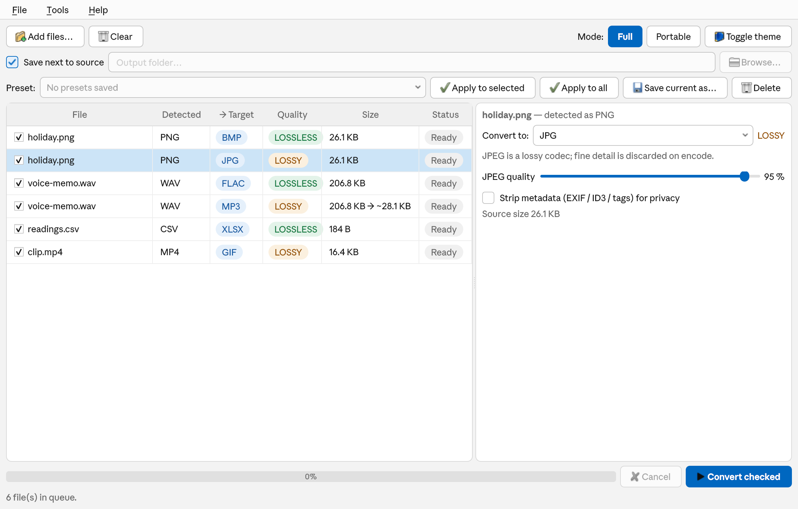

# Converter

> **Windows only for now.** This release ships a Windows build (`Converter.exe`).
> The app is cross-platform Python/PySide6 and runs from source on macOS and
> Linux, but packaged builds for those platforms aren't available yet.

A desktop app that converts images, audio, video, data, documents and 3D models
**100% locally and offline** — and is honest about quality: before converting, it
tells you whether the conversion is lossless or lossy.

[](LICENSE)



## Features

- **Six categories in one queue:** images, audio, video, data, documents and 3D models.
- **Content-based detection.** The format is detected from the file's *content*
  (magic bytes / structure), not its extension — so a mislabeled file is still
  handled correctly.
- **Honest quality badges.** Every target shows one of:
  - 🟢 **LOSSLESS** — no data is lost (e.g. PNG → BMP, WAV → FLAC, CSV → TSV)
  - 🟠 **LOSSY** — some data is lost; the app explains *why* and uses
    maximum-quality defaults (e.g. PNG → JPG, WAV → MP3)
  - ⚪ **UNAVAILABLE** — needs an external tool/codec that isn't installed
    (shown greyed out with install instructions)
- **Batch queue** that never freezes the UI and never aborts on a single bad file.
- **Presets** and a conversion **history**.
- Impossible pairs (e.g. MP4 → XLSX) are simply never offered.

### Supported formats

| Category | Inputs | Outputs |
|----------|--------|---------|
| **Images** (Pillow) | png, jpg, webp, bmp, tiff, gif, ico (+ heic, avif with optional codecs) | png, jpg, webp, bmp, tiff, gif, ico, heic, avif |
| **Audio** (ffmpeg) | any audio | wav, flac, mp3, aac, m4a, ogg, opus |
| **Video** (ffmpeg) | any video | mp4, mkv, mov, webm, avi, gif |
| **Data** (pandas) | csv, tsv, json, yaml, xlsx, ods, xml | csv, tsv, json, yaml, xlsx, ods, xml |
| **Documents** (structured engine / LibreOffice / pandoc) | pdf, docx, odt, rtf, md, txt, html, epub | docx, odt, rtf, pdf, md, txt, html, epub |
| **3D models** (trimesh) | obj, stl, ply, glb, gltf, 3mf | obj, stl, ply, glb, gltf |

Notes:
- WAV/FLAC audio and PNG/BMP/TIFF/WebP images are lossless; the lossy codecs use
  maximum-quality defaults (JPEG quality 95, video CRF 18).
- Spreadsheets are read as **values only** (formulas, formatting and extra sheets
  are dropped); XML conversions are approximate.
- 3MF is **input-only**; multi-object 3D scenes are merged into a single mesh when
  the target is stl/obj/ply (reported as lossy).
- Document conversion is best effort, not pixel-faithful. PDF imports are rebuilt
  from the page geometry (headings, paragraphs, lists, tables) with pdfminer.six;
  the DOCX output can keep the editable structure or reproduce the printed layout.

## Download (Windows)

Grab the latest archive from the
**[Releases page](https://github.com/brighinatommaso-eng/Converter/releases)**:
`Converter-v0.1.2-windows.zip`.

1. Download and **extract the whole zip** to a folder (don't run it from inside the
   archive). You should see `Converter.exe` next to an `_internal` folder.
2. Run **`Converter.exe`**.

> **Windows SmartScreen:** the executable is **not code-signed**, so the first run
> may show a blue "Windows protected your PC" dialog. Click **More info → Run
> anyway**. (The app is open source; you can also run it from source, below.)

The **SHA256 checksum** of the zip is published in the **release notes** on the
[Releases page](https://github.com/brighinatommaso-eng/Converter/releases).

The archive also includes `LICENSE`, `THIRD_PARTY_NOTICES.md` and a `licenses/`
folder with the third-party license texts (ffmpeg, pandoc).

## External tools

Converter works out of the box for images, audio, video, data and 3D models; some
document features use external tools. Missing tools only disable the conversions
that need them — everything else keeps working, and the app shows a dependency
report on startup (also under **Help → Dependencies**).

| Tool | Needed for | Bundled in the release? |
|------|-----------|--------------------------|
| **ffmpeg / ffprobe** | all audio & video | ✅ included in the bundle |
| **pandoc** | markdown / html / epub / txt ↔ docx / odt / rtf | ✅ included in the bundle |
| **LibreOffice** | office documents (docx/odt/rtf/html/pdf) | ❌ detected on your system — [install](https://www.libreoffice.org/download/) |
| **Tesseract + Ghostscript + ocrmypdf** | OCR of scanned PDFs | ❌ detected on your system |

To install the external tools:

| Tool | Windows | macOS | Linux |
|------|---------|-------|-------|
| ffmpeg | `winget install Gyan.FFmpeg` | `brew install ffmpeg` | `sudo apt install ffmpeg` |
| LibreOffice | `winget install TheDocumentFoundation.LibreOffice` | `brew install --cask libreoffice` | `sudo apt install libreoffice` |
| Tesseract | `winget install UB-Mannheim.TesseractOCR` | `brew install tesseract` | `sudo apt install tesseract-ocr` |
| Ghostscript | `winget install ArtifexSoftware.GhostScript` | `brew install ghostscript` | `sudo apt install ghostscript` |

> **PDF → DOCX / ODT / RTF / MD / TXT / HTML is rebuilt in-process.**
> The structured document engine uses **pdfminer.six** and **python-docx** (both
> MIT), so no AGPL PDF library is required. PDF → DOCX/MD/TXT/HTML works in both
> modes; ODT and RTF also need LibreOffice for the final docx → odt/rtf step.

## Run from source

Requires **Python 3.10+**.

```bash
pip install -r requirements.txt
python -m converter
```

For audio/video you also need **ffmpeg** on your `PATH` (see the table above).

## Build

The Windows executable is built with **PyInstaller** (onedir) using
[`converter.spec`](converter.spec), which bundles ffmpeg/ffprobe/pandoc if they are
found on `PATH` at build time:

```bash
pip install pyinstaller
pyinstaller converter.spec --noconfirm --clean
# result: dist/Converter/Converter.exe  (+ dist/Converter/_internal)
```

A zip of `dist/Converter` is the release archive.

## Tests

```bash
pip install -r requirements.txt
pytest
```

The suite covers content detection, registry/target logic, the lossless/lossy
verdict matrix, and end-to-end image/data/document/audio/video/3D conversions.

For real-document regression checks, put PDFs/DOCX in `tests/corpus/local/`
(gitignored) and follow [`tests/corpus/README.md`](tests/corpus/README.md): the
harness compares the reconstructed structure (headings, reading order, lists,
tables) against reviewable JSON baselines.

## Status

Working: image, audio, video, data, document and 3D conversions, presets and
history. Not done yet: the **command-line front-end is only a stub** (use the
GUI), and a watch-folder mode is not implemented.

## License

MIT — see [`LICENSE`](LICENSE). Third-party components and their licenses are
listed in [`THIRD_PARTY_NOTICES.md`](THIRD_PARTY_NOTICES.md). ffmpeg, LibreOffice,
pandoc and Tesseract are used as external tools / separate executables.
